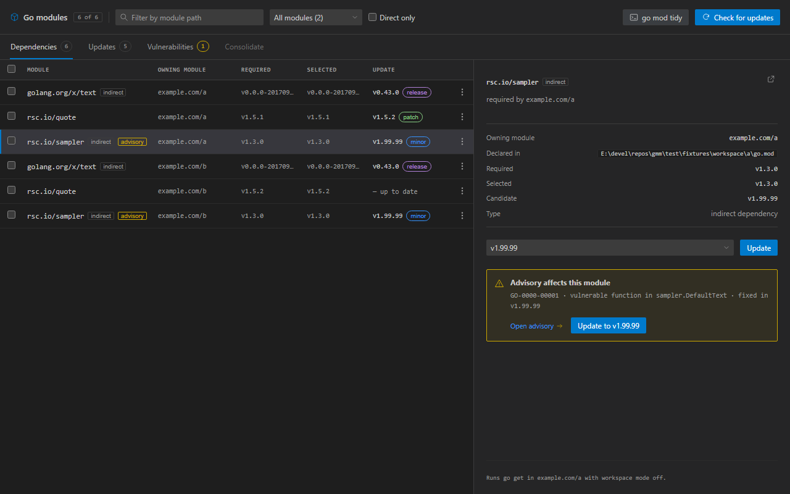

# GMM — Go Module Manager

GMM shows the dependencies of every `go.mod` in your workspace and moves them to other versions — without touching code you did not ask it to touch.



## Install

```sh
code --install-extension mihaimyh.go-module-manager
```

Or search for **GMM** in the Extensions view. Marketplace page: [mihaimyh.go-module-manager](https://marketplace.visualstudio.com/items?itemName=mihaimyh.go-module-manager).

## What it does

- Lists every project in the workspace and its direct and indirect dependencies, read live from the Go toolchain.
- Fills in available updates in the background, cached by the content of `go.mod` and `go.sum`.
- Shows published advisories as an amber **advisory** chip, and — only after you ask — the ones reachable from your own code as a red **reachable** chip with the symbol that reaches them.
- Updates a single dependency or a whole selection: one `go get` per project, with one level of undo.
- Runs `go mod tidy` only from its own confirmed button. Never after an update.
- Sends no telemetry, runs no builds or tests, and never edits `.go` files.

## Requirements

- Go 1.21 or newer on `PATH` (or set `gmm.goPath`).
- VS Code 1.85 or newer.

## Usage

1. Open a folder that contains one or more `go.mod` files.
2. Click the **Go Modules** icon in the Activity Bar to open the panel in the editor (the side bar shows a short welcome with the same command), press the GMM button in the Explorer toolbar, use the editor-title button while a `go.mod` is open, press **Ctrl+Alt+G** (**Cmd+Alt+G** on macOS), or run **GMM: Open Go Module Manager** from the Command Palette.
3. Declared versions appear immediately; updates fill in per project.
4. Select rows to update them together, or open the inspector to pick a version.
5. Open **Vulnerabilities** and press **Scan reachable** for a precise check.

The precise scan runs `go run golang.org/x/vuln/cmd/govulncheck@latest`, so it never depends on an installed binary and always uses the current scanner. Installing the CLI is a separate, optional action.

## Settings

| Setting | Default | Meaning |
| --- | --- | --- |
| `gmm.goPath` | `go` | Path to the Go executable. |

## Scope

v0.1 covers reading, updating, tidying and advisory checking for Go modules. Not included yet: browsing or installing new modules, consolidation writes across a workspace, major-version import migration, and other ecosystems.

Private module paths matching `GOPRIVATE` / `GONOPROXY` are never sent to the advisory database.

## Development

```sh
npm install
npm run build     # bundles extension + webview into dist/
npm run typecheck
npm test
npm run package   # produces a .vsix
```

Press `F5` to launch the extension host against the fixture workspace in `test/fixtures/workspace`.

Publishing uses Microsoft Entra ID from a developer machine:

```sh
az login
npx vsce publish --no-dependencies --azure-credential
```

CI only attaches the VSIX to the GitHub release; global Azure DevOps PATs are retired on 2026-12-01.

Architecture: `src/core` is ecosystem-neutral, `src/ecosystems/go` holds everything Go-specific, `src/extension` is the VS Code host and `src/webview` is the panel. Decisions live in `docs/adr/`, vocabulary in `GLOSSARY.md`, scope in `docs/design.md`.
